# Mini NPU Simulator

코디세이 **「AI가 계산하는 방식을 흉내 내는 작은 계산기 만들기」** 미션 프로젝트입니다.

숫자로 표현한 패턴과 필터를 비교하여 MAC(Multiply-Accumulate) 점수를 계산하고, 어떤 필터와 더 유사한지 판정하는 Python 콘솔 프로그램입니다.

---

## 1. 개발 환경

- OS: Windows
- Python: 3.14.10
- Git: 2.56.0.windows.4
- VS Code: 1.145.3
- 외부 라이브러리 사용 없음
- Python 표준 라이브러리만 사용

### 개발 환경 확인


---

## 2. 프로젝트 초기 구성

프로젝트는 다음 파일을 중심으로 구성했습니다.

- `main.py` : Mini NPU 프로그램 본체
- `data.json` : 필터 및 패턴 데이터
- `README.md` : 실행 방법과 결과 리포트
- `evidence/` : 실행 검증 스크린샷

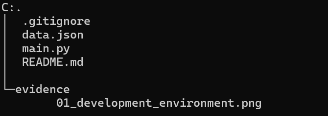

---

## 3. Git 초기화

프로젝트 폴더를 Git 저장소로 초기화하고 `main` 브랜치에서 개발했습니다.

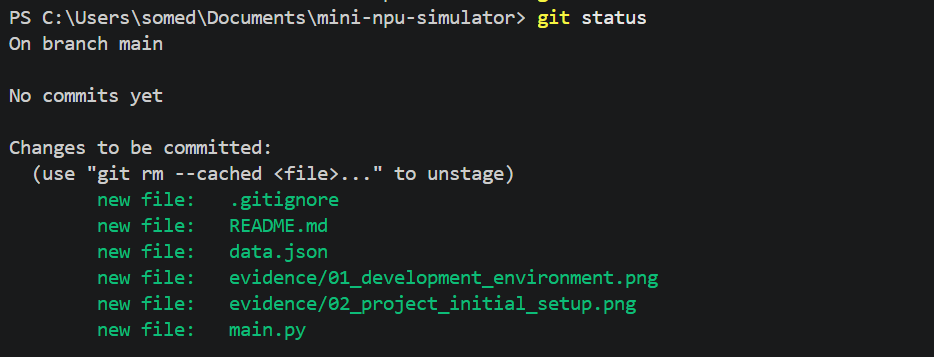

---

## 4. 프로그램 실행 방법

프로젝트 폴더에서 다음 명령어를 실행합니다.

```powershell
python main.py
```

실행하면 다음 메뉴가 표시됩니다.

1. 사용자 입력 모드 (3×3)
2. `data.json` 분석 모드
0. 프로그램 종료

---

## 5. 모드 1 - 사용자 입력 3×3

사용자가 필터 A, 필터 B, 패턴을 각각 3×3 숫자 배열로 입력합니다.

같은 위치의 값을 곱한 후 모든 값을 누적하여 MAC 점수를 계산합니다.

예를 들어 십자가 패턴과 십자가 필터를 비교하면 점수가 높게 나오고, X 필터와 비교하면 상대적으로 낮은 점수가 나옵니다.

### MAC 계산 및 판정

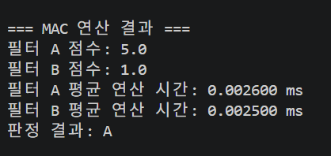

두 필터의 MAC 점수를 비교하여 다음과 같이 판정합니다.

- A 점수가 크면 `A`
- B 점수가 크면 `B`
- 두 점수 차이가 epsilon보다 작으면 `판정 불가`

---

## 6. epsilon 기반 동점 처리

부동소수점 계산에서는 두 값이 논리적으로 같더라도 아주 작은 오차가 발생할 수 있습니다.

따라서 다음 기준을 사용합니다.

```text
abs(score_a - score_b) < 1e-9
```

위 조건을 만족하면 두 점수를 같은 것으로 보고 모드 1에서는 `판정 불가`로 출력합니다.

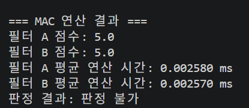

---

## 7. 사용자 입력 오류 처리

3×3 입력에서 다음 오류를 검사합니다.

- 한 행에 숫자가 3개가 아닌 경우
- 숫자로 변환할 수 없는 값을 입력한 경우

오류가 발생하면 프로그램을 종료하지 않고 같은 행을 다시 입력하도록 했습니다.

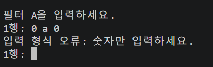

---

## 8. 모드 2 - data.json 분석

`data.json`에는 다음 크기의 필터와 패턴이 저장되어 있습니다.

- 5×5
- 13×13
- 25×25

패턴 키는 다음 형식입니다.

```text
size_N_idx
```

예를 들어:

```text
size_5_1
size_13_2
size_25_1
```

프로그램은 패턴 키에서 `N`을 추출하여 해당 크기의 `size_N` 필터를 선택합니다.

예를 들어 `size_13_2`라면 `13`을 추출하여 `size_13` 필터와 비교합니다.

---

## 9. 라벨 정규화

외부 데이터의 라벨 표현이 서로 다르더라도 프로그램 내부에서는 두 개의 표준 라벨만 사용합니다.

```text
+       → Cross
cross   → Cross
x       → X
```

이를 `normalize_label()` 함수에서 처리합니다.

`expected` 값뿐만 아니라 필터의 `cross`, `x` 키도 같은 정규화 규칙을 사용하여 프로그램 내부에서는 `Cross`, `X`로 통일합니다.

라벨 정규화를 별도 함수로 만든 이유는 다음과 같습니다.

- 서로 다른 라벨 표현을 하나의 형식으로 통일할 수 있습니다.
- 필터 키와 expected 값에 동일한 규칙을 적용할 수 있습니다.
- 향후 라벨 규칙이 변경되더라도 한 곳만 수정하면 됩니다.

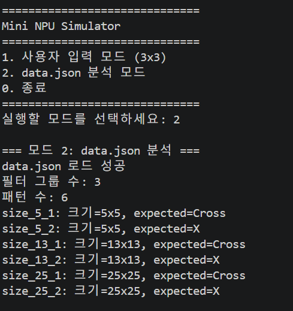

---

## 10. JSON MAC 판정 및 PASS/FAIL

각 패턴에 대해 다음 순서로 처리합니다.

1. 패턴 키에서 크기 N 추출
2. `size_N` 필터 선택
3. 필터 라벨을 `Cross`, `X`로 정규화
4. expected 라벨 정규화
5. Cross 필터와 MAC 계산
6. X 필터와 MAC 계산
7. 두 점수 비교
8. expected와 비교하여 PASS 또는 FAIL 출력

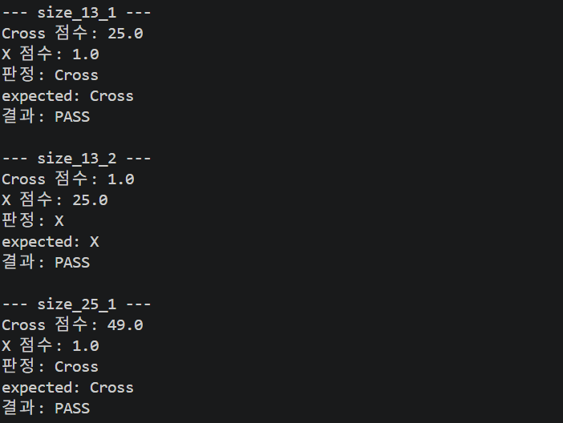

정상 테스트 데이터에서는 전체 6개 케이스가 모두 PASS 되었습니다.

---

## 11. 모드 2 동점 처리

모드 2에서 두 점수의 차이가 epsilon보다 작으면 결과를 `UNDECIDED`로 처리합니다.

expected는 `Cross` 또는 `X`이므로 `UNDECIDED`는 expected와 일치하지 않으며 해당 케이스는 FAIL로 집계됩니다.

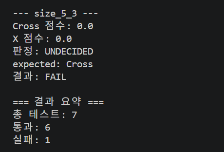

모드 1에서는 사람이 결과를 확인하므로 `판정 불가`라고 출력하고, 모드 2에서는 자동 분석 결과를 구분하기 위해 `UNDECIDED`라는 문자열을 사용했습니다.

---

## 12. 성능 분석

MAC 연산은 각 크기별로 10회 반복 실행하고 평균 시간을 계산합니다.

측정 대상은 파일 읽기나 화면 출력 시간이 아니라 MAC 연산 함수가 실제로 실행되는 구간입니다.

성능 표에는 다음 값을 출력합니다.

- 크기 N×N
- 평균 MAC 연산 시간(ms)
- 연산 횟수 N²

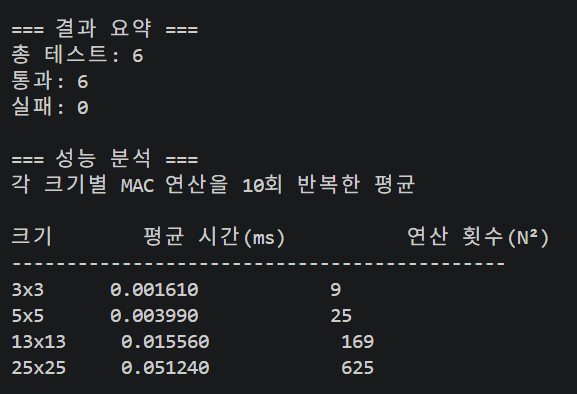

각 배열 크기의 원소 수는 다음과 같습니다.

```text
3×3   = 9
5×5   = 25
13×13 = 169
25×25 = 625
```

입력 크기가 커질수록 MAC 연산량도 증가합니다.

---

## 13. 크기 불일치 오류 처리

패턴 키에서 추출한 크기와 실제 배열의 크기가 다르면 해당 케이스를 FAIL로 처리합니다.

예를 들어 `size_5_3`이라는 키인데 실제 입력 배열이 3×3이라면 5×5 데이터가 아니므로 FAIL입니다.

중요한 점은 하나의 잘못된 데이터 때문에 전체 프로그램이 종료되지 않고, 해당 케이스만 FAIL 처리한 뒤 나머지 케이스 분석을 계속한다는 것입니다.

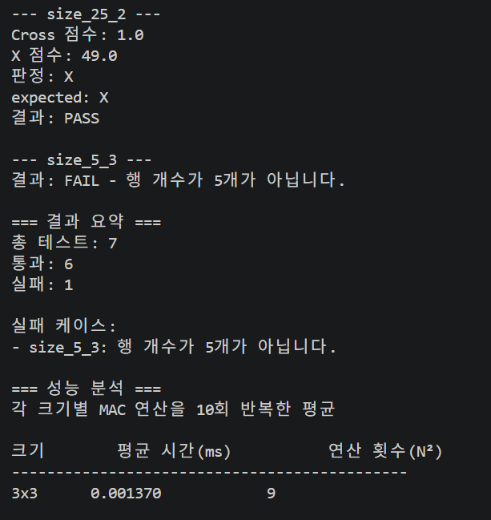

---

## 14. MAC 연산 구조

MAC은 Multiply-Accumulate의 약자입니다.

쉽게 설명하면 **같은 위치의 숫자를 곱하고, 그 결과를 계속 더하는 계산**입니다.

프로그램에서는 다음 흐름으로 구현했습니다.

1. 패턴과 필터의 같은 위치를 선택합니다.
2. 두 숫자를 곱합니다.
3. 계산된 값을 `score`에 더합니다.
4. 모든 행과 열에 대해 반복합니다.
5. 최종 누적 점수를 반환합니다.

핵심 계산은 다음과 같습니다.

```python
score += pattern[row][column] * filter_matrix[row][column]
```

패턴과 필터에서 높은 값이 같은 위치에 많이 존재할수록 곱셈 결과의 합이 커집니다.

따라서 이 미션에서는 MAC 점수가 높은 필터를 입력 패턴과 더 유사한 필터라고 판단합니다.

---

## 15. 결과 리포트

이번 프로그램에서는 사용자 입력, JSON 데이터 구조, 라벨 변환, 수치 비교 문제를 각각 나누어 처리했습니다.

`normalize_label()`을 사용하여 `+`, `cross`, `x`처럼 서로 다른 라벨 표현을 `Cross`와 `X`로 통일했습니다.

필터 키 역시 같은 정규화 함수를 사용하기 때문에 라벨 표현 방식이 달라도 동일한 판정 로직을 사용할 수 있습니다.

부동소수점 값은 계산 과정에서 아주 작은 오차가 발생할 수 있으므로 정확한 `==` 비교 대신 epsilon `1e-9`를 사용했습니다.

두 MAC 점수의 차이가 epsilon보다 작으면 사실상 같은 값으로 판단합니다.

모드 1에서는 사람이 결과를 확인하므로 동점 결과를 `판정 불가`라고 표시합니다.

모드 2에서는 expected와 자동 비교해야 하므로 동점을 `UNDECIDED`라는 표준 결과로 표시하고 FAIL로 집계합니다.

JSON 패턴의 크기가 필터 크기와 일치하지 않는 경우에는 잘못된 데이터로 판단하여 해당 케이스만 FAIL 처리합니다.

이 과정에서 하나의 오류 때문에 전체 프로그램이 종료되지 않도록 예외 처리를 적용했습니다.

MAC 연산은 N×N 배열의 모든 위치를 한 번씩 확인합니다.

따라서 필터 하나를 계산할 때 확인해야 하는 위치의 수는 N²입니다.

3×3은 9개, 5×5는 25개, 13×13은 169개, 25×25는 625개의 위치를 계산합니다.

N이 증가하면 처리해야 하는 칸의 수가 N²에 비례하여 증가하므로 MAC 함수의 시간 복잡도는 O(N²)입니다.

실제 측정 시간은 컴퓨터의 상태나 Python 실행 환경에 따라 조금씩 달라질 수 있습니다.

하지만 배열 크기가 커질수록 처리해야 하는 연산량이 증가한다는 점은 동일합니다.

성능 측정에서는 파일 읽기와 화면 출력 시간을 제외하고 MAC 함수 실행 구간만 반복 측정했습니다.

한 번만 측정하면 실행 환경에 따라 시간이 흔들릴 수 있으므로 각 크기에서 10회 반복한 평균 시간을 사용했습니다.

정상 테스트 데이터에서 0 FAIL이 나온 것은 라벨 정규화, 배열 크기 검사, epsilon 기반 비교 정책이 정상적으로 적용되었기 때문입니다.

---

## 16. 시간 복잡도

패턴의 한 변 크기를 N이라고 하면 전체 원소 수는 다음과 같습니다.

```text
N × N = N²
```

MAC 연산은 모든 위치를 한 번씩 방문하므로 시간 복잡도는 다음과 같습니다.

```text
O(N²)
```

예를 들어 25×25 배열은 625개의 위치를 확인하므로 5×5 배열의 25개 위치보다 훨씬 많은 계산이 필요합니다.

---

## 17. 주요 함수

- `read_matrix()` : 사용자 3×3 입력 및 오류 검사
- `mac()` : MAC 점수 계산
- `measure_mac_time()` : MAC 평균 연산 시간 측정
- `decide_mode1()` : 모드 1 A/B/판정 불가 결정
- `normalize_label()` : 라벨을 Cross/X로 정규화
- `extract_size_from_key()` : `size_N_idx`에서 N 추출
- `validate_matrix_size()` : 패턴 및 필터 크기 검사
- `decide_mode2()` : Cross/X/UNDECIDED 판정
- `run_mode1()` : 사용자 입력 모드 실행
- `run_mode2()` : JSON 일괄 분석 실행
- `show_performance_analysis()` : 성능 분석 표 출력

---

## 18. 최종 실행 검증

최종 실행에서는 `data.json`의 전체 테스트 케이스에 대해 MAC 계산과 PASS/FAIL 판정을 수행했습니다.

그 다음 3×3, 5×5, 13×13, 25×25 크기의 성능을 분석하고 마지막에 전체 결과를 출력했습니다.

최종 실행 결과는 다음과 같습니다.

```text
총 테스트: 6
통과: 6
실패: 0
```

전체 6개 테스트가 모두 정상적으로 통과했습니다.

또한 각 크기에 대해 MAC 연산을 10회 반복하여 평균 실행 시간을 측정했습니다.

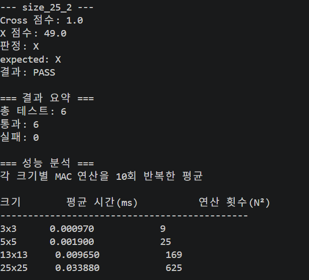

---

## 19. GitHub 저장소 등록

로컬 Git 저장소를 GitHub 원격 저장소와 연결하고 `main` 브랜치를 Push했습니다.

GitHub 저장소:

```text
https://github.com/nanhwasong/codyssey-mini-npu
```

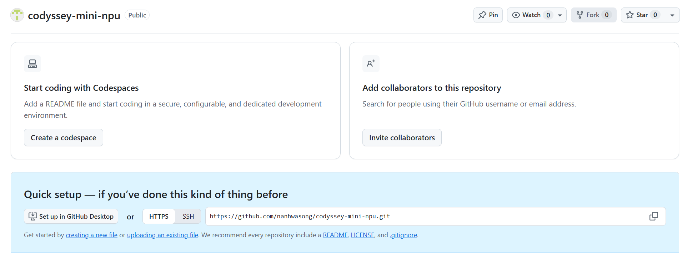

---

## 최종 정리

이 프로젝트에서는 Python 반복문을 사용하여 NPU의 핵심 연산 중 하나인 MAC 연산을 간단하게 구현했습니다.

패턴과 필터를 숫자 배열로 표현하고, 같은 위치의 값을 곱하여 누적한 점수를 기준으로 패턴을 판정했습니다.

또한 사용자 입력 오류, JSON 데이터 크기 오류, 라벨 표현 차이, 부동소수점 오차와 같은 문제를 처리하도록 구현했습니다.

마지막으로 여러 크기의 배열에 대해 MAC 실행 시간을 측정하여 배열 크기가 증가할수록 연산량이 N²에 비례하여 증가한다는 것을 확인했습니다.