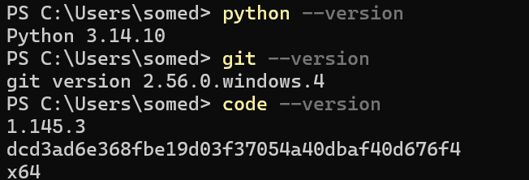

# Mini NPU Simulator

코디세이 `<AI가 계산하는 방식을 흉내 내는 작은 계산기 만들기>` 미션 프로젝트입니다.

Python으로 MAC(Multiply-Accumulate) 연산을 직접 구현하고, 패턴과 필터의 유사도를 계산하는 Mini NPU 시뮬레이터를 개발합니다.

## 1. 개발 환경

- OS: Windows
- Python: 3.14.10
- Git: 2.56.0.windows.4
- VS Code: 1.145.3
- 외부 라이브러리 사용 없음

### 개발 환경 확인



## 2. 프로젝트 초기 구성

프로젝트 시작 시 `main.py`, `data.json`, `README.md`, `.gitignore`, `evidence` 폴더를 구성하고 Git 저장소를 초기화했습니다.


## 3. 주요 기능

- 3×3 사용자 입력 모드
- 필터 A/B 및 패턴 입력
- 입력값 검증
- MAC 연산
- epsilon 기반 점수 비교
- `data.json` 분석
- Cross/X 라벨 정규화
- JSON 스키마 및 크기 검증
- 케이스별 PASS/FAIL 판정
- 성능 측정
- 전체 테스트 결과 리포트

## 4. 실행 방법

프로젝트 폴더에서 다음 명령어를 실행합니다.

```powershell
python main.py
```

## 5. 결과 리포트

프로그램 완성 후 다음 내용을 추가합니다.

- 전체 테스트 결과
- 실패 케이스 분석
- 라벨 정규화 처리
- 부동소수점과 epsilon 비교 정책
- 패턴 크기에 따른 MAC 연산 시간
- 시간 복잡도 O(N²) 분석